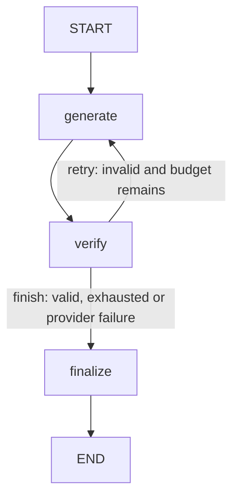

# Agent Smith - Framework-Based Architecture

An independent personal project exploring an autonomous AI coding agent, with a framework-based architecture to compare against a separate from-scratch implementation. It is not an official school project.

## Status

Phase 3 adds an actual LangGraph StateGraph for bounded Generate -> Verify -> Revise/Finalize. Phase 1 packaging and Phase 2 one-shot Gemini commands remain available. At most two LLM requests per task, and generated code is never executed. No tools, MCP, sandbox or benchmark agents are implemented. Phase 4 requires the owner's approval.

Agent Smith v1.1 is the functional reference. This experimental variant deliberately uses LangGraph despite the reference's orchestration-framework prohibition; it does not claim compliance with the original evaluation.

## Installation and offline checks

Prerequisites: uv and Git. The project targets Python 3.10; uv selects an appropriate interpreter independently of the system Python.

```powershell
uv sync --locked
uv run --locked python --version
uv run --locked agent-smith
uv run --locked agent-smith --version
uv run --locked pytest
uv lock --check
```

`agent-smith` without a live option only validates settings. It does not construct a model or contact a service. `--env-file PATH` remains supported. Missing `.env` and missing API credentials are allowed for these offline checks.

## Configuration

Copy `.env.example` to `.env` if desired. Edit the latter locally; never paste a key into chat or commit it. `.env` and `.env.*` are ignored, while `.env.example` is tracked.

| Variable | Default and validation |
|---|---|
| SMITH_ENVIRONMENT | development; development/test/production |
| SMITH_LOG_LEVEL | INFO; DEBUG/INFO/WARNING/ERROR/CRITICAL; validated, logging not configured yet |
| SMITH_LLM_PROVIDER | google; only provider supported in this phase |
| SMITH_LLM_MODEL | gemini-3.1-flash-lite; nonblank, configurable, no fallback |
| SMITH_LLM_API_KEY | absent; SecretStr, excluded from repr and model serialization; required only for a live operation |
| SMITH_LLM_TIMEOUT_SECONDS | 30; finite, greater than zero, at most 300 seconds |
| SMITH_LLM_TEMPERATURE | 1.0; finite, between 0 and 2 |
| SMITH_LLM_MAX_OUTPUT_TOKENS | 1024; positive integer, at most 65536 |

Environment variables override the selected UTF-8 dotenv file, which overrides defaults. Unknown dotenv entries are rejected. This can reject a dotenv shared with other applications. `load_settings(None)` disables dotenv but still reads environment variables. Settings objects are frozen.

The model identifier `gemini-3.1-flash-lite` was verified against official Gemini API documentation on 2026-11-06. This does not verify access for your account, region, or quota. No silent model replacement occurs.

## Optional live test - explicit opt-in only

1. Obtain your own Gemini Developer API key through Google AI Studio with an available free-tier quota. Do not enable billing or purchase credits for this project. Access and free quotas must be checked in your own account.
2. Run `Copy-Item .env.example .env` only if you do not already have a local configuration to preserve.
3. Open `.env` locally and set `SMITH_LLM_API_KEY`. Keep it private.
4. Explicitly execute:

```powershell
uv run --locked agent-smith --env-file .env --llm-smoke-test
```

The fixed question is: "Explain in two sentences what a Python IndexError is."

Expected: a textual answer followed by latency in seconds. A missing key, authentication refusal, quota/rate limit, unavailable model, timeout, network failure, empty response, or unexpected provider failure produces a safe error and exit code 2. No raw provider exception is printed. The response length/instruction is not guaranteed by this transport test.

For a custom single request:

```powershell
uv run --locked agent-smith --env-file .env --prompt "Write a Python function that returns the maximum of three numbers."
```

Both commands opt into a real service call. The adapter invokes once and explicitly sets SDK total attempts to 1; no application retry, fallback, or key rotation. No live request was executed during Phase 2 implementation. A later user-authorized smoke test succeeded (exit 0, latency 1.187 seconds). Phase 3 has made no live requests. The timeout configures the HTTP request timeout, not a hard process-wide execution deadline. Model-produced text is displayed, never executed. The CLI redacts an exact occurrence of the configured key if echoed in returned text.

## Architecture and request flow

CLI -> Settings -> GeminiProvider -> LangChain HumanMessage -> ChatGoogleGenerativeAI -> Google GenAI SDK -> Gemini Developer API -> AIMessage -> LLMResponse.

The application contract is `ChatProvider.ask(prompt) -> LLMResponse`; it exposes no LangChain message types. `LLMResponse` contains text, configured provider/model, optional TokenUsage, locally measured latency_seconds, and optional finish_reason. Missing token fields remain None; no token counts are estimated. The configured model is recorded, not a claim about an exact backend model revision. Latency measures invocation, including LangChain and transport overhead, not server-only processing.

The provider explicitly selects Developer API (`vertexai=False`), passes only the configured key, disables LangSmith tracing for invocation, and never rethrows raw provider messages. Public errors retain no original exception chain. SecretStr masks display but does not encrypt values in memory or secure the workstation. No source code execution is involved.

LangChain supplies messages, invoke and provider-response normalization; Google integration supplies the SDK adapter. Only `langchain-core` and `langchain-google-genai` are directly added, not the umbrella `langchain` package, which is unnecessary here and could pull orchestration dependencies. Phase 2 uses no agent factory. Phase 3 adds the explicit StateGraph described below.

## Tests and limitations

Automated tests are offline: fake chat models, a patched Google SDK generate_content boundary, and a fixture denying socket connections. Generated dummy credentials are used; no real key is embedded. Original Phase 1 tests are retained. CLI subprocess checks exercise only default startup/version, never live options.

The SDK-boundary tests exercise real LangChain conversion, timeout milliseconds and one-attempt options without sending an HTTP request. They do not prove live authentication or model access. See PROJECT_PROGRESS.md for executed counts and ARCHITECTURE_DECISIONS.md for choices.

No rotation, provider fallback, persistent conversation, model streaming, tools, process sandbox or benchmark. The bounded Phase 3 graph provides orchestration only. Docker/LangChain/LangGraph alone do not make generated code safe.

## Dependencies and resources

Python 3.10.22 used during implementation. Resolved versions include Pydantic 2.14.3, pydantic-settings 2.15.0, langchain-core 1.7.6, langchain-google-genai 4.4.3, google-genai 2.33.0, pytest 9.2.0. PyPI Requires-Python metadata and uv's complete dependency resolution were checked. pydantic-settings remains pinned because its newer line requires Python 3.11. `uv.lock` records all transitive versions.

- [Gemini 3.1 Flash-Lite API identifier](https://ai.google.dev/gemini-api/docs/models/gemini-3.1-flash-lite)
- [LangChain Gemini integration](https://docs.langchain.com/oss/python/integrations/chat/google_generative_ai)
- [Pydantic Settings](https://docs.pydantic.dev/latest/concepts/pydantic_settings/)
- [uv projects](https://docs.astral.sh/uv/guides/projects/)
- Functional reference: local Agent Smith v1.1 PDF, not redistributed.

Codex assisted with specification analysis, architecture, source, tests, dependency checks and documentation. The project owner should review and understand the implementation. The other project's files have not been inspected.


### Token zero ambiguity

Installed LangChain converts some absent Google token counters into zero. To avoid fabricating measured zeros, this adapter conservatively exposes zero counters as None (unknown); positive reported counters are retained. This also loses the distinction of a genuine reported zero. Complete absence of usage remains None. Real SDK-boundary tests cover both absent and partial metadata. No total is calculated by the application.


## Phase 3 - bounded static-verification workflow

An application-owned AlphaCodium-Lite workflow is implemented with LangGraph 1.2.20 StateGraph. It does not use an external AlphaCodium package and has no functional test-execution stage. The existing GeminiProvider is injected through ChatProvider; no second client is created.



- `generate_node`: build the initial/correction prompt, attempt one provider call, count it, retain available latency and usage. Corrections include the previous proposal and static observation.
- `verify_node`: extract raw Python or one Python Markdown block, inspect with ast.parse, record an attempt and assign status/reason. Multiple ambiguous fences, empty output, comment-only and string-only modules are rejected.
- `decide_next_step`: deterministic conditional-edge router, not an LLM call.
- `finalize_node`: create AgentResult, sum recorded call latencies and aggregate only known token counters. No LLM call.

The Python implementation explicitly uses START, END, add_node, add_edge, add_conditional_edges and compile. `run_agent` invokes the compiled graph, never a while-loop orchestration. A recursion limit of 8 leaves room for the maximum five node executions; it is independent of the business budget.

### State and contracts

`agent/models.py` defines Pydantic VerificationResult, AttemptRecord, AgentState and AgentResult. `agent/nodes.py` defines GraphState, a TypedDict carrying the same application fields plus transient response, error code, per-call latency, start time and final result. Node boundaries revalidate the application fields with AgentState; TypedDict itself is not a runtime validator. Credentials and provider objects are never stored in graph state. `build_graph` captures an injected provider; each invocation has a fresh history. No persistence or checkpoint store is configured.

AgentState includes task, generated_code, llm_calls, max_llm_calls, attempts, status, stop_reason, last_observation and elapsed_seconds. Budgets are strict integers 1 or 2; defaults use 2. At least one generation is mandatory for every accepted task. Successful parsing stops immediately; unused budget is not consumed. Attempts use default_factory lists, sequential iterations, verification results and available metadata. Frozen Pydantic objects prevent field reassignment, not deep list mutation; nodes build new history lists instead of mutating shared state.

| Outcome | Status | Stop reason / next step |
|---|---|---|
| Syntax passes | unverified | syntax_passed_functionality_unverified; finalize after one call if the first proposal passes |
| Invalid/empty/unusable, budget remains | needs_revision | one correction via conditional edge |
| Invalid/empty/unusable, budget exhausted | failed | budget_exhausted |
| Auth/quota/timeout/network/model/key/provider failure | failed | provider_*; immediate controlled termination, never a syntax retry |
| Invalid configuration | failed in workflow, or CLI rejects before initialization | configuration_invalid; no retry |

Provider errors still pass through verify to record a structure-level observation explicitly saying that static verification was NOT performed. They are not reported as syntax failures. A provider empty_response is the special recoverable case: it may trigger one correction. An attempted call counts even when the provider raises. Initialization failures before ask do not consume a graph call.

Total latency is the sum of recorded provider-call latencies, not total graph wall time; elapsed_seconds tracks the latter in internal state. Failed calls use local monotonic timing. Task token totals are reported per field only when every attempt supplies that field; otherwise None. Per-attempt known values are retained. Synthetic demo latencies are explicitly labelled and are not benchmark results.

### Offline demonstration

```powershell
uv run --locked python examples/phase3_offline.py
```

This uses scripted responses and the real compiled graph. It never imports or constructs GeminiProvider. It demonstrates one-call syntax acceptance, error then correction, and budget exhaustion. It does not execute the proposed Python. `docs/phase3_graph.mmd` is exported from the compiled graph locally, with no rendering service.

### Explicit live agent mode - do not run without approval

```powershell
uv run --locked agent-smith --env-file .env --agent-task "Write a Python function that returns the maximum of three numbers"
```

This opts into up to TWO real Gemini calls. It is mutually exclusive with --prompt and --llm-smoke-test. Output contains proposed code, status, stop reason, number of calls and total call latency. A failed workflow returns exit code 2; unverified returns 0 only to indicate workflow completion, not functional correctness. The default command remains offline. This live agent command was NOT executed during Phase 3.

### Limits and comparison

ast.parse builds an Abstract Syntax Tree (AST). It does not execute code, validate runtime names, verify the task's requirements, or prove that a function works. It can accept constructs that later fail during compilation/runtime, such as return in an invalid context. No eval, exec or process running generated code exists. This is a bounded coding workflow with static checks, not a sandbox or a functional correctness guarantee. Parser resource limits and adversarial large-input isolation are not implemented.

Compared conceptually with From Scratch: the same provider contract, prompts, verification policy and result models can be used. LangGraph manages state propagation, node scheduling, conditional edges and termination; a custom version would implement that control flow directly. Business budgets, error policy and AST limitations remain our responsibility. The separate project's files have not been inspected. See ARCHITECTURE_DECISIONS.md and PROJECT_PROGRESS.md for details and actual test results.
